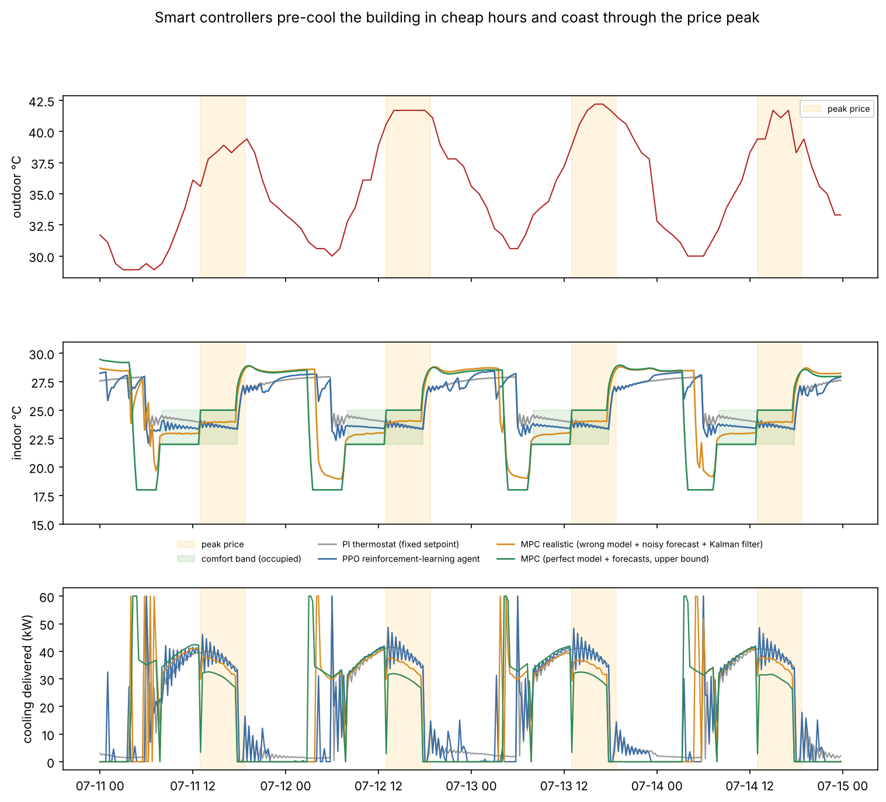
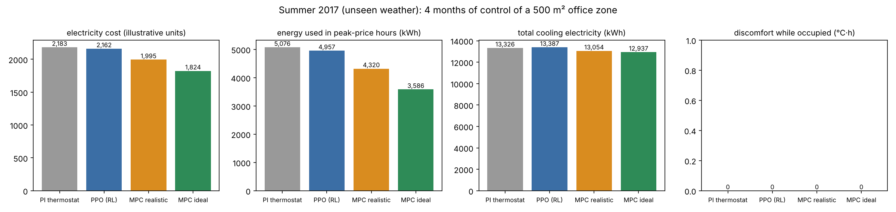

# Smart HVAC Control: Model Predictive Control vs Reinforcement Learning

Controlling the air conditioning of an office zone under **time-of-use electricity prices**, in **real
2016–2017 weather** from a hot US site (summer highs above 45 °C). The goal is to pay less for cooling, and
use less power during the expensive peak, **without making occupants uncomfortable**.

Four controllers are compared on **4 months of unseen summer weather** (June–September 2017, 15-minute steps):

| Controller | Electricity cost ↓ | Peak-hour energy ↓ | Total energy | Comfort violations |
|---|---|---|---|---|
| PI thermostat (fixed setpoint; today's standard) | baseline | baseline | baseline | 0 |
| PPO reinforcement-learning agent (residual setpoint) | −1.0 % | −2.3 % | +0.5 % | 0 |
| **MPC, realistic**: wrong model + noisy forecast + Kalman filter | **−8.6 %** | **−14.9 %** | −2.0 % | **0** |
| MPC, ideal: perfect model and forecasts (upper bound) | −16.4 % | −29.4 % | −2.9 % | 0 |

All numbers are produced by `src/evaluate.py` and stored in `results/metrics.json`.



**What the smart controllers learned:** cool the building's concrete at night and in the morning, when
power is cheap and the building can still store "coolness", then let the indoor temperature drift up to
the top of the comfort band through the 13:00–19:00 price peak, using much less cooling exactly when it
is most expensive.



## 1. The building: a 2R2C thermal model

One 500 m² office zone described by two temperatures:

* `T_i`: indoor air and furniture (heats and cools within about an hour)
* `T_m`: building mass such as concrete slabs and walls (about 13 hours; **not measurable** in practice)

```
C_i dT_i/dt = (T_m − T_i)/R_im + (T_o − T_i)/R_io + Q_internal + Q_solar − Q_cool
C_m dT_m/dt = (T_i − T_m)/R_im + (T_o − T_m)/R_mo
```

"2R2C" means two capacitors (heat storage `C`) and resistors (heat paths `R`), the same maths as an
electrical RC circuit. The model is linear, so it is discretised **exactly** for 15-minute steps with
the matrix exponential (zero-order hold), giving `x[k+1] = A x[k] + B u[k] + E d[k]`.

* **Outdoor temperature `T_o`:** real hourly measurements (BDG2 dataset, site "Fox"). Summer 2016 is used
  for training and tuning; summer 2017 only for the final test.
* **Internal gains:** 25 W/m² when occupied (weekdays 08:00–18:00), 6 W/m² otherwise.
* **Solar gain:** 15 kW peak, clear-sky profile.
* **Air conditioner:** up to 60 kW of cooling. Its electric power is `Q_cool / COP`, where COP drops by
  0.08 per °C of outdoor temperature above 25 °C (hotter outside means less efficient).
* **Tariff (illustrative):** 0.08 per kWh off-peak and 0.30 per kWh from 13:00 to 19:00 on weekdays.
* **Comfort band:** 22–25 °C while occupied, 18–30 °C otherwise.

## 2. The controllers

**PI thermostat.** A proportional-integral loop with anti-windup tracks 23.5 °C during occupancy (starting
2 h early) and a 28 °C setback otherwise. It knows nothing about prices or the weather forecast.

**MPC (model predictive control).** Every 15 minutes it plans the next 24 hours of cooling by solving a
**linear program** (SciPy / HiGHS):

```
minimise   Σ_k  price_k · Q_k / COP_k · Δt   +   λ · Σ_k s_k · Δt
subject to T_i,k+1 = free response + G·Q   (the building model, written as one matrix)
           low_k + margin − s_k ≤ T_i,k+1 ≤ high_k − margin + s_k
           0 ≤ Q_k ≤ 60 kW,  s_k ≥ 0       (s = comfort violation, heavily penalised)
```

It applies only the first action, then re-plans 15 minutes later (receding horizon).

* *Ideal MPC* plans with the true model, perfect weather forecasts and the true (unmeasurable) `T_m`.
  It shows the most that is achievable.
* *Realistic MPC* has to cope with three imperfections:
  1. **Wrong model:** every capacitance and resistance is off by 10–25 %.
  2. **Forecast error:** temperature-forecast error grows as a random walk, to about ±2 °C a day ahead.
  3. **Hidden state:** the indoor thermometer is noisy (±0.1 °C) and `T_m` is never measured. A
     **steady-state Kalman filter** (gain from the discrete algebraic Riccati equation) estimates both
     temperatures from the indoor reading alone.

  To keep occupants comfortable despite these errors it plans inside a band tightened by a safety
  margin (constraint tightening). The margin was chosen on **2016** weather (`src/tune_mpc_margin.py`):

  | Margin (°C) | Cost saving (2016 tuning) | Time outside comfort band |
  |---|---|---|
  | 0.0 | 12.8 % | 26.0 % |
  | 0.5 | 10.8 % | 2.7 % |
  | 1.0 (chosen) | 8.6 % | 0.0 % |

**PPO agent (reinforcement learning).** A Gymnasium environment wraps the same building. Every 15 minutes
the agent observes indoor temperature and its recent trend, outdoor temperature now and forecast (+1/3/6 h),
time, occupancy and upcoming prices. It then shifts the thermostat's setpoint by an offset from −6 to +1 °C
(residual control: offset 0 is exactly the thermostat), and the same PI loop executes it. The reward is
`−(cost + 20 · comfort violation)`. It is trained with Stable-Baselines3 PPO for 1.5 M steps on summer 2016.

## 3. Honest findings about RL

The PPO agent stays perfectly comfortable but finds only ~1 % of savings, about 6 % of what ideal MPC
reaches. Three earlier designs did worse: direct power control with 7 or 13 levels, and absolute setpoint
choice. They learned to **over-cool** to avoid the large comfort penalty and saved 0.7–2 %, sometimes
costing more than the thermostat. Likely reasons:

* The benefit of pre-cooling is small per step and only shows up hours later. That is a hard
  credit-assignment problem next to the large, immediate comfort penalty.
* MPC is handed the building model; the agent must discover the slow mass dynamics purely from experience.

Promising fixes (not done here): train on many more episodes, add an MPC-imitation warm start, or use the
MPC's cost-to-go as reward shaping. The takeaway matches the building-control literature: **when a decent
physics model exists, MPC is the stronger and more sample-efficient choice**; RL needs far more data or
model help.

## Run it

```bash
pip install -r requirements.txt
python src/download_data.py        # weather data (~19 MB)
python src/evaluate.py             # ~3 min: runs all 4 controllers, writes results/
python src/tune_mpc_margin.py      # optional: margin tuning on 2016 (~2 min)
python src/train_ppo.py            # optional: retrain PPO (~25-40 min); a trained model is in models/
```

## Project structure

```
src/building_model.py   2R2C physics, exact discretisation, weather / occupancy / tariff schedules
src/controllers.py      PI thermostat, MPC (LP + Kalman filter), PPO wrapper, simulation + metrics
src/hvac_env.py         Gymnasium environment for RL
src/train_ppo.py        PPO training (Stable-Baselines3)
src/tune_mpc_margin.py  safety-margin tuning on 2016 data
src/evaluate.py         final comparison on 2017, plots
models/ppo_hvac.zip     trained agent
```
